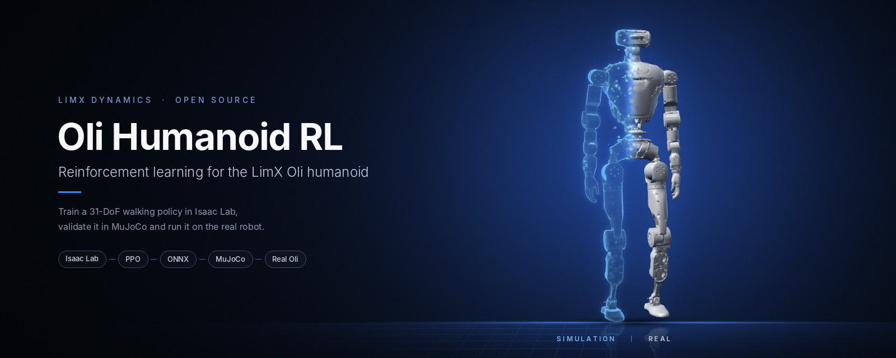
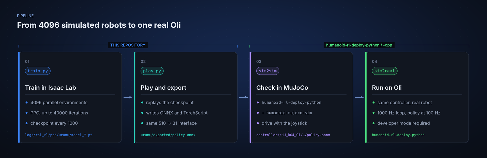
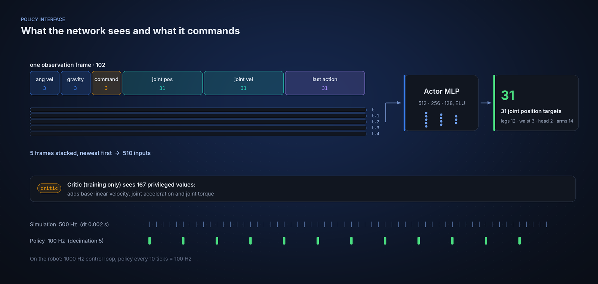

<p align="center">
  
</p>

<p align="center">
  <a href="README.md">English</a> | <a href="README_cn.md">中文</a>
</p>

<p align="center">
  <a href="LICENSE"></a>
  <a href="https://github.com/limxdynamics/humanoid-rl-isaaclab/actions/workflows/ci.yml"></a>
  
  <a href="https://github.com/isaac-sim/IsaacLab/releases/tag/v2.0.0"></a>
  
  
</p>

# humanoid-rl-isaaclab

Reinforcement learning environments and training scripts for the LimX Dynamics
**Oli** humanoid: train a 31-DoF walking policy in Isaac Lab, export it to ONNX,
check it in MuJoCo and run it on the real robot.

> Training needs a machine that can run Isaac Sim 4.5 with an NVIDIA GPU. To look
> at the robot or try the pretrained policy without Isaac Sim, see
> [Quick start in 30 seconds](#quick-start-in-30-seconds).

## Highlights

- **One command to train a full-body humanoid.** `LimX-Oli-31dof-Velocity` trains
  all 31 joints (legs, waist, head and arms) across 4096 parallel environments.
- **A tested sim-to-real path.** Train here, check the policy in MuJoCo with the
  deployment controller, then run the same controller on the physical Oli.
- **Deploy-ready export.** `play.py` writes `policy.onnx` with the exact
  510-input, 31-output interface that the LimX Python and C++ deployment
  controllers load.
- **Robustness built into training.** Friction, actuator gains, link masses,
  centre of mass and inertia are randomised, and the robot is pushed and hit with
  external forces at random intervals.
- **Readable, tunable rewards.** Velocity tracking plus gait timing, foot
  clearance, posture and energy terms, with every weight in one config file.
- **Self-contained PPO.** Ships an `rsl_rl` 2.3.2 fork with asymmetric
  actor-critic and entropy decay, so no separate RL library install is needed.

## Sim to real

<div align="center">

| Isaac Lab | MuJoCo | Physical Oli |
|:---:|:---:|:---:|
|  |  |  |

</div>

## Tasks

| Task ID | Use | Environments | Robot asset |
|---|---|---|---|
| `LimX-Oli-31dof-Velocity` | Train a velocity-tracking walking policy | 4096 | `HU_D04_01` (Oli, 31 DoF) |
| `LimX-Oli-31dof-Velocity-Play` | Replay and export a trained policy | 100 | `HU_D04_01` (Oli, 31 DoF) |

Both tasks are registered in
[`robots/oli/31dof/__init__.py`](source/limx_rl_forge/limx_rl_forge/tasks/locomotion/robots/oli/31dof/__init__.py)
and configured in
[`velocity_env_cfg.py`](source/limx_rl_forge/limx_rl_forge/tasks/locomotion/robots/oli/31dof/velocity_env_cfg.py).

## How it fits together

<p align="center">
  
</p>

The policy sees five stacked frames of proprioception and outputs joint position
targets for all 31 joints; the critic additionally sees privileged state during
training only:

<p align="center">
  
</p>

### Training at a glance

| Item | Value |
|---|---|
| Simulation / policy rate | 500 Hz physics (`dt` 0.002 s), policy every 5 steps = 100 Hz |
| Episode length | 20 s |
| Velocity commands | forward −0.5 to 1.0 m/s, lateral ±0.3 m/s, yaw ±1.0 rad/s |
| Terrain | flat plane (stairs, slopes and rough patches are defined in [`terrain/rough.py`](source/limx_rl_forge/limx_rl_forge/tasks/locomotion/terrain/rough.py) with proportion 0) |
| Randomisation | friction, actuator stiffness and damping, base/waist/leg mass, waist centre of mass, inertia, pushes every 5–15 s, external force and torque |
| PPO | actor and critic 512-256-128 ELU, 32 steps per env, up to 40000 iterations, checkpoint every 1000 |

## Quick start in 30 seconds

No Isaac Sim is needed to look at Oli. Open the same robot model used for
training in the MuJoCo viewer:

```bash
pip install mujoco
git clone https://github.com/limxdynamics/humanoid-description.git
python -m mujoco.viewer --mjcf=humanoid-description/HU_D04_description/xml/HU_D04_01.xml
```

To see a pretrained walking policy in simulation, follow the MuJoCo steps in
[humanoid-rl-deploy-python](https://github.com/limxdynamics/humanoid-rl-deploy-python),
which ships a default `policy.onnx` for `HU_D04_01`.

## Installation

- Create a virtual environment with **Python 3.10**:
``` sh
conda create -n limx python=3.10
conda activate limx
```

- Install **PyTorch 2.5.1** build based on the CUDA version available on your system:
``` sh
pip install torch==2.5.1 --index-url https://download.pytorch.org/whl/cu121
```

- Install **IsaacSim 4.5.0** packages:
``` sh
pip install isaacsim[all,extscache]==4.5.0 --extra-index-url https://pypi.nvidia.com
```

- Download **IsaacLab 2.0.0** from [Releases](https://github.com/isaac-sim/IsaacLab/releases), and install it by:
``` sh
./isaaclab.sh -i none
```

- Clone this repository and install the dependencies:
``` sh
git clone https://github.com/limxdynamics/humanoid-rl-isaaclab.git
cd humanoid-rl-isaaclab
pip install -r requirements.txt
```

- Download the robot description files **into the root of this repository**. The
  robot config loads `humanoid-description/HU_D04_description/usd/HU_D04_01.usd`
  relative to the repository root:
``` sh
git clone https://github.com/limxdynamics/humanoid-description.git
```

- Verify that the installation and list all the available environments:
``` sh
python scripts/list_envs.py
```
Then you will see the following output:


## Training

- Train your agent with:
``` sh
python scripts/rsl_rl/train.py --headless --task LimX-Oli-31dof-Velocity
```
Checkpoints are written to `logs/rsl_rl/ppo/<date-time>/model_<iteration>.pt`.
Add `--num_envs N` to reduce GPU memory use, or `--max_iterations N` to stop earlier.

- Evaluate the latest trained agent and export it:
``` sh
python scripts/rsl_rl/play.py --task LimX-Oli-31dof-Velocity-Play
```
By default this loads the newest `model_*.pt` from the newest run in
`logs/rsl_rl/ppo/`. Use `--load_run <date-time>` to pick a run, or
`--checkpoint <path/to/model.pt>` to load a specific file.
This also writes `policy.onnx` and `policy.pt` to
`logs/rsl_rl/ppo/<date-time>/exported/`.

## Deployment

Please refer to the following projects for the `sim2sim` and `sim2real` instructions:
- [Deployment with Python](https://github.com/limxdynamics/humanoid-rl-deploy-python)
- [Deployment with C++](https://github.com/limxdynamics/humanoid-rl-deploy-cpp)

For the Python controller, copy your exported `policy.onnx` to
`controllers/HU_D04_01/walk_controller/policy/default/` in
humanoid-rl-deploy-python, then follow its MuJoCo and real-robot steps.

## License

The original code in this repository is released under the
[Apache License 2.0](LICENSE). Files derived from Isaac Lab and the bundled
[`rsl_rl_lib`](rsl_rl_lib) keep their BSD-3-Clause licenses; see
[`THIRD_PARTY_NOTICES.md`](THIRD_PARTY_NOTICES.md) for the file list and license texts.

## Acknowledgments
This project is built upon several excellent projects:
- [IsaacLab](https://github.com/isaac-sim/IsaacLab)
- [Mujoco](https://github.com/google-deepmind/mujoco.git)
- [rsl_rl](https://github.com/leggedrobotics/rsl_rl)
