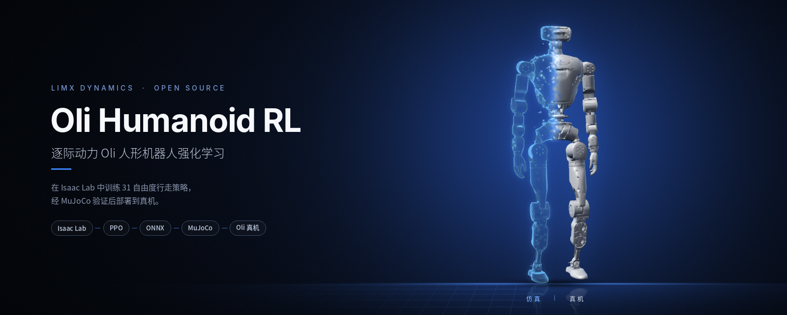
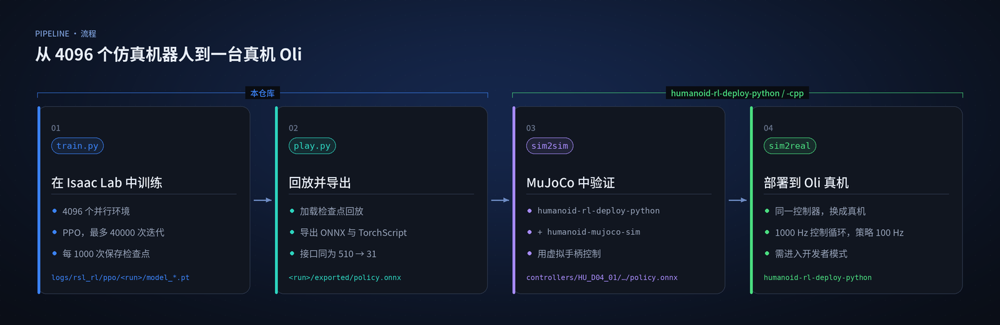
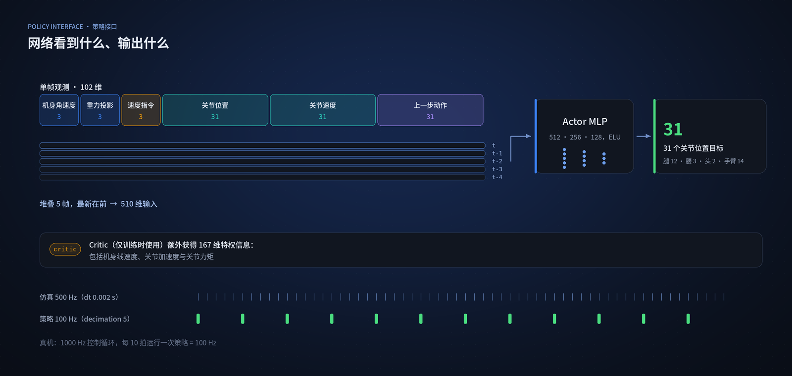

<p align="center">
  
</p>

<p align="center">
  <a href="README.md">English</a> | <a href="README_cn.md">中文</a>
</p>

<p align="center">
  <a href="LICENSE"></a>
  
  <a href="https://github.com/isaac-sim/IsaacLab/releases/tag/v2.0.0"></a>
  
  
</p>

# humanoid-rl-isaaclab

逐际动力 **Oli** 人形机器人的强化学习环境与训练脚本：在 Isaac Lab 中训练 31 自由度行走策略，
导出为 ONNX，在 MuJoCo 中验证后部署到真机。

> 训练需要能运行 Isaac Sim 4.5 的 NVIDIA GPU 机器。如果只想看看机器人，或在没有 Isaac Sim
> 的情况下试用预训练策略，请见 [30 秒快速开始](#30-秒快速开始)。

## 亮点

- **一条命令训练全身人形机器人。** `LimX-Oli-31dof-Velocity` 在 4096 个并行环境中训练全部
  31 个关节（腿、腰、头和手臂）。
- **经过验证的仿真到真机路径。** 在本仓库训练，用部署控制器在 MuJoCo 中验证，再用同一控制器
  驱动 Oli 真机。
- **导出即可部署。** `play.py` 导出的 `policy.onnx` 采用 510 维输入、31 维输出的接口，
  与逐际动力 Python 和 C++ 部署控制器加载的格式一致。
- **训练中内置鲁棒性。** 随机化摩擦、执行器增益、连杆质量、质心与惯量，并在随机时刻推搡机器人、
  施加外力与外力矩。
- **奖励清晰、易于调整。** 速度跟踪，加上步态节奏、抬脚高度、姿态与能耗项，所有权重集中在一个
  配置文件中。
- **自带 PPO。** 内置 `rsl_rl` 2.3.2 分支，支持非对称 Actor-Critic 与熵衰减，无需另装强化学习库。

## 从仿真到真机

<div align="center">

| Isaac Lab | MuJoCo | Oli 真机 |
|:---:|:---:|:---:|
|  |  |  |

</div>

## 训练任务

| 任务 ID | 用途 | 环境数 | 机器人资产 |
|---|---|---|---|
| `LimX-Oli-31dof-Velocity` | 训练速度跟踪行走策略 | 4096 | `HU_D04_01`（Oli，31 自由度） |
| `LimX-Oli-31dof-Velocity-Play` | 回放并导出训练好的策略 | 100 | `HU_D04_01`（Oli，31 自由度） |

两个任务在
[`robots/oli/31dof/__init__.py`](source/limx_rl_forge/limx_rl_forge/tasks/locomotion/robots/oli/31dof/__init__.py)
中注册，配置位于
[`velocity_env_cfg.py`](source/limx_rl_forge/limx_rl_forge/tasks/locomotion/robots/oli/31dof/velocity_env_cfg.py)。

## 整体流程

<p align="center">
  
</p>

策略输入为堆叠 5 帧的本体感知信息，输出全部 31 个关节的位置目标；Critic 仅在训练时额外获得特权状态：

<p align="center">
  
</p>

### 训练参数一览

| 项目 | 取值 |
|---|---|
| 仿真 / 策略频率 | 物理仿真 500 Hz（`dt` 0.002 s），每 5 步运行一次策略 = 100 Hz |
| 单回合时长 | 20 s |
| 速度指令 | 前向 −0.5 至 1.0 m/s，横向 ±0.3 m/s，偏航 ±1.0 rad/s |
| 地形 | 平地（楼梯、斜坡与粗糙地形已在 [`terrain/rough.py`](source/limx_rl_forge/limx_rl_forge/tasks/locomotion/terrain/rough.py) 中定义，比例为 0） |
| 随机化 | 摩擦、执行器刚度与阻尼、躯干/腰部/腿部质量、腰部质心、惯量、每 5–15 s 推搡、外力与外力矩 |
| PPO | Actor 与 Critic 均为 512-256-128 ELU，每环境 32 步，最多 40000 次迭代，每 1000 次保存 |

## 30 秒快速开始

查看 Oli 不需要 Isaac Sim。用 MuJoCo 查看器打开与训练相同的机器人模型：

```bash
pip install mujoco
git clone https://github.com/limxdynamics/humanoid-description.git
python -m mujoco.viewer --mjcf=humanoid-description/HU_D04_description/xml/HU_D04_01.xml
```

想在仿真中看预训练的行走策略，可按照
[humanoid-rl-deploy-python](https://github.com/limxdynamics/humanoid-rl-deploy-python)
中的 MuJoCo 步骤操作，该仓库为 `HU_D04_01` 提供了默认的 `policy.onnx`。

## 安装

- 创建 **Python 3.10** 虚拟环境:
``` sh
conda create -n limx python=3.10
conda activate limx
```

- 根据您系统上的 CUDA 版本安装 **PyTorch 2.5.1**:
``` sh
pip install torch==2.5.1 --index-url https://download.pytorch.org/whl/cu121
```

- 安装 **IsaacSim 4.5.0** 软件包:
``` sh
pip install isaacsim[all,extscache]==4.5.0 --extra-index-url https://pypi.nvidia.com
```

- 从 [IsaacLab官网](https://github.com/isaac-sim/IsaacLab/releases) 下载**2.0.0**版本并安装:
``` sh
./isaaclab.sh -i none
```

- 下载项目代码并安装依赖:
``` sh
git clone https://github.com/limxdynamics/humanoid-rl-isaaclab.git
cd humanoid-rl-isaaclab
pip install -r requirements.txt
```

- 将机器人资产文件下载到**本仓库根目录**下。机器人配置会相对仓库根目录加载
  `humanoid-description/HU_D04_description/usd/HU_D04_01.usd`：
``` sh
git clone https://github.com/limxdynamics/humanoid-description.git
```

- 验证安装并列出所有可用训练环境:
``` sh
python scripts/list_envs.py
```
将看到如下输出：


## 训练

- 训练模型：
``` sh
python scripts/rsl_rl/train.py --headless --task LimX-Oli-31dof-Velocity
```
检查点保存在 `logs/rsl_rl/ppo/<日期-时间>/model_<迭代次数>.pt`。
可加 `--num_envs N` 降低显存占用，或加 `--max_iterations N` 提前结束。

- 回放并导出最新训练的模型：
``` sh
python scripts/rsl_rl/play.py --task LimX-Oli-31dof-Velocity-Play
```
默认加载 `logs/rsl_rl/ppo/` 下最新一次训练中最新的 `model_*.pt`。可用 `--load_run <日期-时间>`
指定某次训练，或用 `--checkpoint <模型路径>` 加载指定文件。
同时会在 `logs/rsl_rl/ppo/<日期-时间>/exported/` 下导出 `policy.onnx` 与 `policy.pt`。

## 模型部署

请参照以下工程代码进行 `sim2sim` 以及 `sim2real` 部署:
- [使用Python部署](https://github.com/limxdynamics/humanoid-rl-deploy-python)
- [使用C++部署](https://github.com/limxdynamics/humanoid-rl-deploy-cpp)

使用 Python 控制器时，将导出的 `policy.onnx` 复制到 humanoid-rl-deploy-python 的
`controllers/HU_D04_01/walk_controller/policy/default/` 目录，再按其 MuJoCo 与真机步骤操作。

## 许可证

本仓库的自研代码以 [Apache License 2.0](LICENSE) 发布。源自 Isaac Lab 的文件与内置的
[`rsl_rl_lib`](rsl_rl_lib) 保留各自的 BSD-3-Clause 许可证，文件清单与许可证全文见
[`THIRD_PARTY_NOTICES.md`](THIRD_PARTY_NOTICES.md)。

## 致谢
本项目基于以下优秀项目构建：
- [IsaacLab](https://github.com/isaac-sim/IsaacLab)
- [Mujoco](https://github.com/google-deepmind/mujoco.git)
- [rsl_rl](https://github.com/leggedrobotics/rsl_rl)
